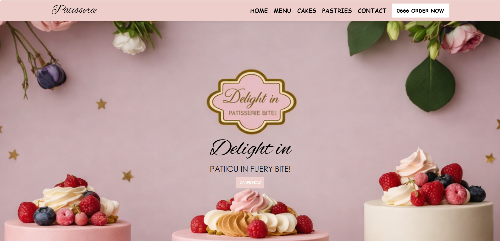
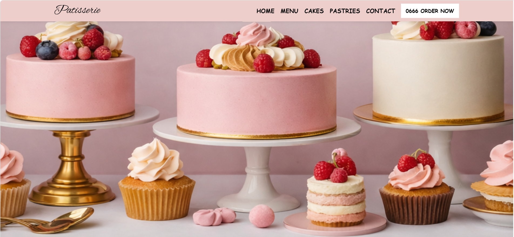
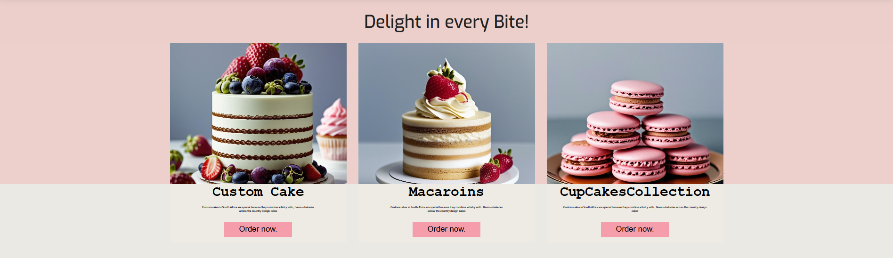
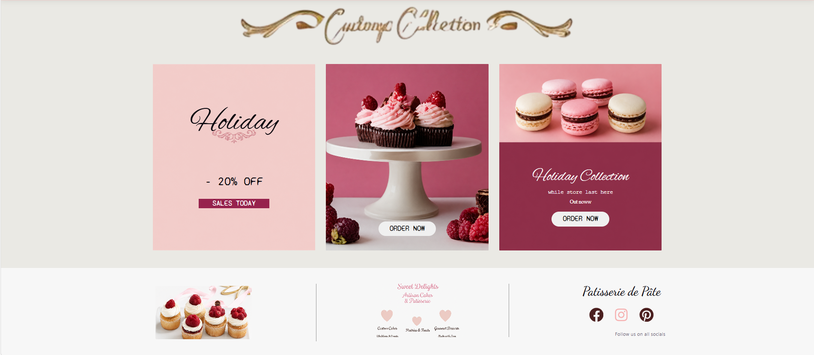

# React UI Challenge Project

A simple React-TS Challenge project containing:

- `App.tsx` — main react file

 ## 📁 Project Structure
 src/
├── assets/
├── components/
│   ├── Cards/
│   │   ├── Card.module.css
│   │   └── Card.tsx
│   ├── Footer/
│   │   ├── Footer.module.css
│   │   └── Footer.tsx
│   ├── ItemCard/
│   │   ├── ItemCard.module.css
│   │   ├── ItemCard.tsx
│   │   └── MenuItem.tsx
│   ├── Navbar/
│   │   ├── Navbar.module.css
│   │   └── Navbar.tsx
│   └── Texts/
│       ├── Text.module.css
│       └── Text.tsx
├── ContentContainer.tsx
├── App.css
├── App.tsx
├── index.css
└── main.tsx

## Getting Started

### Prerequisites

- [Node.js](https://nodejs.org/) (which includes npm)
- Git, if you are cloning the repository

### Run locally

1. Clone the repository and move into the project directory:

   ```sh
   git clone https://github.com/Boipelo-85/ReactTS-UI-Challenge.git
   cd ReactTS-UI-Challenge
   ```

   If you already have the project files, open a terminal in the project directory instead.

2. Install the dependencies:

   ```sh
   npm install
   ```

3. Start the Vite development server:

   ```sh
   npm run dev
   ```

4. Open the local URL printed in the terminal (usually `http://localhost:5173`) in your browser. Keep the terminal running while you use the app.

### Production build

To create and preview a production build, run:

```sh
npm run build
npm run preview
```

Open the preview URL printed in the terminal.

## Features

Users are able to:
 
- Users are able to see a full Cake UI design
- See different design of cakes and size
- See hover and focus states for all interactive elements
- See all available buttons where they can orders their cakes of choice
- See all available specials are currently in the store
- See all different social platforms for a user to contact the store or view more cakes in the website.


---

### Screenshot






---

### Links

- **Live Site:** [View Live](react-ts-ui-challenge-six.vercel.app)
- **Repository:** [GitHub Repo](https://github.com/Boipelo-85/ReactTS-UI-Challenge.git)
---
 
## My Process


### Built With
 
- React-ts
- CSS (Media Queries)
- Vite
---

### What I Learned
 
Working on this project helped me practice and improve my skills in:
 
- **React Components** using Rreact-ts .
- **Responsive design** — using media queries to switch the layout from side-by-side on desktop and mobile
- **CSS** — for structuring the challenge layout cleanly

 
 
### Continued Development
 
In future projects I want to:
 
- Improve my CSS animation skills to add smoother transitions between the form and success message
- Practice building more components with a mobile-first approach from the start
---
 
## Author
 
- **Name:** Boipelo Harry Motileng
- **GitHub:** [github.com/boipelo](https://github.com/Boipelo-85)
- **LinkedIn:** [linkedin.com/in/boipelo](https://www.linkedin.com/in/boipelo-motileng)
---
